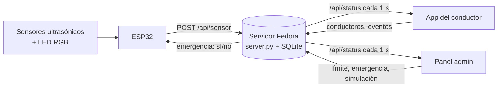

# 🅿️ ParkUni

**Estacionamiento inteligente para el campus.** Sensores ultrasónicos con LED RGB en cada cajón le dicen a una app web, en tiempo real, cuáles están libres. La app funciona como un "Waze" del estacionamiento: asigna el cajón disponible más cercano **por ruta real**, guía con indicaciones de giro y voz, **redirige** si alguien ocupa el lugar mientras el conductor llega y vigila el **límite de velocidad** con el GPS del celular.

> Proyecto escolar — Circuitos, Semestre 3.

## 🎨 Identidad visual

Paleta de la Universidad Anáhuac Cancún: **blanco y naranja** de día, **negro y naranja** de noche, con grises neutros. El naranja (`#f7941d`) marca lo importante (botones, ruta, cajón asignado); el verde y el rojo se reservan para libre / ocupado. Las variables de color están al inicio de [`public/css/base.css`](public/css/base.css) y [`map.css`](public/css/map.css). El logo está en `public/img/` (versión clara y versión para fondo oscuro).

## 🗺️ Dos mapas

| Mapa | Para qué sirve |
|---|---|
| **Prototipo** (por defecto) | La maqueta con los **4 sensores reales**: un pasillo con 4 cajones. Todo lo que se ve viene de los sensores, sin simulación. Es la prueba. |
| **Campus completo** | El estacionamiento real de la universidad (~590 cajones en 5 zonas), para mostrar **cómo se vería si se usara**. Solo los cajones con sensor son reales; el resto se simula. |

Se cambia con el selector del panel de administración o en ⚙ Ajustes → *Mapa* de la app (también con `?map=prototype` o `?map=campus` en la URL).

## ✨ Funciones

**App del conductor** (`index.html`)
- Asignación del cajón libre más cercano respetando carriles de un solo sentido y la rotonda.
- **Zona preferida**: al abrir la app te pregunta dónde prefieres estacionarte (o "Más cercana"), y lo puedes cambiar después desde la pantalla de inicio. Busca primero ahí; si no hay lugar, en las **zonas cercanas** (p. ej. Norte → Este y Acceso norte) y, al final, en cualquier otra. Las zonas cercanas se definen en `zoneNear` de `map-data.js`.
- **Sin duplicados**: cada cajón se **reserva** en el servidor al asignarlo, así que dos conductores nunca reciben el mismo. Los cajones que ya lleva otro conductor se ven con borde punteado.
- Mapa que gira con el auto e instrucciones tipo "Entra a la rotonda, salida 2 hacia Acceso norte, 89 m".
- **Redirección automática** si el cajón asignado se ocupa en camino (en el campus, si no queda nada, manda a la Terrazería o a la zona de maestros).
- **Velocidad por GPS** con alerta visual, sonora y de voz al pasar el límite.
- Voz con prioridades: *emergencia* > *reducir velocidad* > *redirigiendo* > *guía de giros*.
- Aviso de **emergencia** a pantalla completa cuando el administrador la activa.
- Tema claro de día y oscuro de noche (automático por hora, con opción manual) y modo demo para presentar sin salir a la calle.

**Panel de administración** (`admin.html`)
- KPIs, estado de cada sensor (distancia, "sin señal"), límite de velocidad, conductores en camino y bitácora.
- **Botón de EMERGENCIA** (ver abajo).
- En el campus: mapa central rodeado de vistas ampliadas por zona (Norte, Acceso norte, Acceso, Este y Sur) con cada cajón en uso; tocar el título de una zona la amplía en el mapa central. Control de la simulación de los cajones sin sensor.
- Tocar un cajón lo fuerza a ocupado / libre / automático (para pruebas).
- **Prueba de LED RGB**: tarjeta para fijar el color de cada LED (rojo, verde, azul, amarillo, morado, cian, blanco, apagado o automático) y así saber cuál canal o LED está dañado sin reprogramar el ESP32 (ver abajo).

## 🚨 Emergencia / simulacro

En el panel hay una tarjeta **Emergencia / simulacro**. Al activarla con la contraseña, **los LED RGB de todos los sensores parpadean en morado** (emergencia) y la app de los conductores muestra un aviso con voz. Se desactiva con la misma contraseña y los LED vuelven a verde/rojo.

- La contraseña se verifica **en el servidor** y vive en `/etc/parkuni.env` (`PARKUNI_EMERGENCY_PASSWORD`), no en el código. Sin ella la emergencia queda bloqueada. Además hay que haber iniciado sesión en el panel.
- 5 intentos fallidos bloquean la prueba durante un minuto y quedan en la bitácora.
- El ESP32 se entera en la respuesta de su siguiente reporte (≈ 1.5 s).

## 💡 Prueba de LED RGB

Sirve para diagnosticar un LED dañado (ya se fundió uno en las pruebas). Se usa desde el **panel web** (tarjeta *Prueba de LED RGB*) o desde el **menú de terminal** (`parkuni` → `l`; ahí también el modo **demo** con `d`, que recorre los colores en cadena, y `x` para dejar todo en automático).

- El servidor guarda la prueba en memoria (`POST /api/ledtest {id: "A1"|"all", color}`) y se la manda al ESP32 en la respuesta de su siguiente reporte (`"test": {"A2": 5}`, máscara R=1 G=2 B=4), así que tarda ≈ 1.5 s.
- Manda sobre libre / ocupado / emergencia, pero solo en los LED en prueba. Se apaga sola a los **3 minutos** (`LED_TEST_TTL`), y el ESP32 la descarta si pierde el servidor 3 reportes seguidos.
- Si un color no se enciende, falla ese canal del LED, su resistencia o su cable.

## 🔐 Acceso al panel

`admin.html` pide **inicio de sesión** (`login.html`). La contraseña (`PARKUNI_ADMIN_PASSWORD`) y la de emergencia viven en `/etc/parkuni.env` (solo root; `instalar.sh` crea la plantilla vacía y las escribes tú con `sudo nano /etc/parkuni.env`, luego `sudo systemctl restart parkuni`). Sin la variable, el panel queda bloqueado.

- Sesión por cookie (`HttpOnly`, `SameSite=Strict`) de 8 horas, en memoria: reiniciar el servidor la cierra. Botón *Cerrar sesión* en el panel.
- 5 intentos fallidos por minuto y por IP bloquean el login; todo queda en la bitácora.
- Rutas de escritura que exigen sesión: `/api/ledtest`, `/api/emergency`, `/api/override`, `/api/overrides/clear`, `/api/sim`, `/api/config`, `/api/reset`. Las del ESP32 y la app del conductor (`/api/sensor`, `/api/claim`, `/api/driver*`, `/api/event`, `/api/status`) siguen abiertas. La bitácora completa (`/api/status?events`) solo se entrega con sesión.
- `PARKUNI_ADMIN_LOCAL_ONLY=1` en `/etc/parkuni.env`: el panel solo se acepta desde esta misma laptop (127.0.0.1).
- El menú de terminal (`parkuni`) pide la contraseña del panel la primera vez que usa LED o emergencia (no la guarda; solo la cookie en memoria).

## 💾 Respaldo de la base

`server/respaldo.py` copia `parkuni.db` con la API de respaldo de SQLite (segura con el servidor encendido), comprueba la integridad de la copia y conserva las últimas 14. **Es manual a propósito**: la laptop del servidor es modesta, así que no hay respaldo automático; el script existe y se usa cuando hace falta.

- Desde el menú: `parkuni` → `b` (*Respaldo de la base*) → Enter → confirmar. Las copias quedan en `~/respaldos-parkuni/` y la pantalla lista las que hay.
- A mano: `python3 server/respaldo.py --dir /ruta` (por ejemplo una memoria USB). Opciones: `--db`, `--dir`, `--keep`.
- Como queda en el mismo disco, de vez en cuando copia esa carpeta a otro lado.

## 🧩 Arquitectura



El mismo servidor sirve la app web y guarda todo en una base SQLite. Para publicarlo en internet, un **Cloudflare Tunnel** apuntando a `localhost:8000` da https sin abrir puertos (y el GPS del celular lo exige).

## 🔌 Hardware (ESP32 + 4 sensores)

Ficha técnica completa: [`docs/Ficha_Tecnica_Estacionamiento.docx`](docs/Ficha_Tecnica_Estacionamiento.docx). ESP32 de 38 pines, 1× AJ-SR04M (impermeable) y 3× HC-SR04, con LED RGB de cátodo común (verde = libre, rojo = ocupado, azul sin uso).

| Cajón | Sensor | ID | Límite | TRIG | ECHO* | LED R | LED G | LED B |
|---|---|---|---|---|---|---|---|---|
| 1 | AJ-SR04M (impermeable) | A1 | 50 cm | 23 | 34 | 32 | 25 | 33 |
| 2 | HC-SR04 | A2 | 10 cm | 22 | 35 | 26 | 27 | 14 |
| 3 | HC-SR04 | A3 | 10 cm | 21 | 36 | 16 | 18 | 17 |
| 4 | HC-SR04 | A4 | 10 cm | 19 | 39 | 5 | 2 | 4 |

\* Cada ECHO lleva un divisor de voltaje (1 kΩ en serie y 2 kΩ a GND) para bajar los 5 V del sensor a 3.3 V. Los sensores se alimentan del pin VIN (5 V); GND común para sensores, cátodos de los LED y divisores.

Firmware:
- [`firmware/parkuni/parkuni.ino`](firmware/parkuni/parkuni.ino) — **el de producción**: mide, pinta los LED, reporta al servidor y parpadea en morado en emergencia. El servidor se busca **por nombre** (`parkuni.local`, mDNS), así que no hay IP que cambiar al mover la laptop de red: solo `WIFI_SSID` si cambia la red, y la laptop debe llamarse `parkuni` (lo hace `server/instalar.sh`). Si el nombre no responde, usa la última IP que funcionó.
- [`firmware/prueba_hardware/prueba_hardware.ino`](firmware/prueba_hardware/prueba_hardware.ino) — el sketch original sin WiFi, para comprobar el cableado.

El id de cada sensor se enlaza con su cajón en `MAP.sensors` de [`public/js/map-data.js`](public/js/map-data.js).

## 📁 Estructura

```
.
├── public/                    ← La app web (la sirve server.py)
│   ├── index.html             App del conductor
│   ├── admin.html             Panel de administración (requiere sesión)
│   ├── login.html             Inicio de sesión del panel
│   ├── css/                   base.css · map.css · driver.css
│   ├── img/                   Logo de la universidad y favicon
│   └── js/
│       ├── config.js          Configuración, tema, GPS y llamadas a la API
│       ├── map-data.js        LOS DOS MAPAS: carriles, filas de cajones, sensores, zonas
│       ├── graph.js           Ruteo, instrucciones de giro, ocupación y simulación
│       ├── mapview.js         Dibujo del mapa (SVG)
│       ├── driver.js          Navegación, voz, velocidad, GPS, emergencia
│       └── admin.js           Panel de administración
├── server/
│   ├── server.py              Servidor + API + SQLite (solo librería estándar)
│   ├── parkuni.service        Servicio systemd para Fedora
│   ├── respaldo.py            Respaldo manual de la base (menú → b)
│   ├── instalar.sh            Instalador para Fedora (sudo bash server/instalar.sh)
│   └── tui/parkuni_tui.py     Menú de terminal para operar el servidor (comando: parkuni)
├── firmware/
│   ├── parkuni/               Firmware del ESP32 (sensores + LED + servidor)
│   └── prueba_hardware/       Prueba del cableado sin WiFi
├── docs/                      Ficha técnica del prototipo y guía de montaje en Fedora (MONTAJE_FEDORA.md)
└── README.md
```

## 🚀 Cómo correrlo

```bash
python3 server/server.py          # http://localhost:8000  (conductor)  ·  /admin.html (panel)
python3 server/server.py --https  # https autofirmado, para probar el GPS desde el celular por la red local
```

Sin ESP32 puedes probar todo: el panel permite forzar cajones y, en el campus, simular el resto. Para simular el reporte de un sensor:

```bash
curl -X POST localhost:8000/api/sensor -d '{"sensors":{"A1":{"occupied":true,"distance_cm":12}}}'
```

### En el servidor (Fedora)
La guía paso a paso, pensada para que Claude Code la ejecute en la máquina, está en [`docs/MONTAJE_FEDORA.md`](docs/MONTAJE_FEDORA.md). En resumen:
1. `sudo bash server/instalar.sh` copia el proyecto a `/opt/parkuni`, crea el usuario y el servicio (arranca solo) e instala `btop`, `sqlite` y el comando `parkuni`.
2. **Firewall:** la zona `FedoraWorkstation` ya permite los puertos 1025-65535, así que el 8000 no necesita regla. Si se usa otra zona, ábrelo solo para la red local. SELinux se queda activo.
3. Las contraseñas (panel y emergencia) van en `/etc/parkuni.env`; `instalar.sh` crea la plantilla vacía. Ver *Acceso al panel*.
4. Escribe `parkuni` para abrir el menú de terminal: sensores en vivo, base de datos (solo lectura), servicio, **cambio de red WiFi**, logs, emergencia, **prueba de LED RGB**, `btop`, **monitor serie del ESP32** (por USB) y activar / desactivar el entorno gráfico. Se abre solo al iniciar sesión en una terminal de texto (`touch ~/.sin-menu` lo desactiva).
5. (Opcional) Cloudflare Tunnel: `cloudflared tunnel --url http://localhost:8000` para tener https público.
6. La base queda en `/opt/parkuni/server/data/parkuni.db` (haz respaldo de ese archivo). Registro de lo instalado y cómo deshacerlo: [`docs/CAMBIOS_SERVIDOR.md`](docs/CAMBIOS_SERVIDOR.md).

## 🗺️ Cómo está hecho el mapa

Los dos mapas están en [`map-data.js`](public/js/map-data.js):

| Elemento | Qué es |
|---|---|
| `nodes` / `edges` | Red de **carriles de un solo sentido** (de `a` a `b`). El ruteo usa solo esto, así que nunca manda a nadie en contra. |
| `segments` | Filas de cajones con su cantidad `n`. Id de cajón: `<fila>-<número>` (p. ej. `S05-12`). En las islas con filas espalda con espalda, cada fila declara el carril que la atiende (`lane`), para que la ruta nunca cruce otra fila de cajones. |
| `sensors` | Qué sensor del ESP32 es qué cajón (`A1: 'P-1'`). |
| `overflow` | (Campus) Terrazería y zona de maestros: último recurso, sin sensores. |
| `uturn: true` | Cruces de vuelta en U permitidos (en el campus: camellón de la curva del acceso norte, que se mueve con `UTURN_AT`, y al inicio de la zona este, entre el carril superior y el pasillo de entrada). |
| `simulate` | `false` en el prototipo: solo cuenta lo que miden los sensores. |

El campus sale de un dibujo del estacionamiento (1920×1080 px, ≈ 0.2 m por píxel).

## 🗄️ Datos (API del servidor)

| Ruta | Quién | Para qué |
|---|---|---|
| `POST /api/sensor` | ESP32 | Reporta los sensores y recibe `emergency` y `test` (prueba de LED) |
| `GET /api/status` | Apps | Estado completo (sensores, límite, conductores, emergencia; eventos con `?events`) |
| `POST /api/login` · `/api/logout` · `GET /api/me` | Panel · menú | Inicia / cierra la sesión de administrador (cookie) y consulta si hay sesión |
| `POST /api/emergency` | Panel (sesión) | `{on, password}` activa o desactiva la emergencia |
| `POST /api/ledtest` | Panel · menú de terminal | `{id, color}`: prueba de LED RGB (`id` = `A1`…`A4` o `all`; `color` = red, green, blue, yellow, purple, cyan, white, off o auto) |
| `POST /api/config` · `/api/sim` · `/api/override` | Panel | Límite de velocidad, simulación y cajones forzados |
| `POST /api/claim` | App | Reserva atómica de un cajón (`{id, spot}`); devuelve `ok: false` si otro conductor ya lo lleva |
| `POST /api/driver` · `/api/event` | App | Latido del conductor y eventos |

## ⚠️ Pendientes y limitaciones

- El panel y las rutas de escritura ya piden sesión, pero `/api/sensor` (ESP32) sigue abierta: cualquiera en la red podría mandar lecturas falsas. Si se publica en internet, conviene un token compartido con el ESP32 y https.
- Los sentidos de algunos carriles de la zona este del campus son una interpretación del dibujo: conviene recorrerlos y corregirlos en `map-data.js`.
- Para ver la posición real del GPS hay que calibrarlo (⚙ → *GPS del celular* → *Fijar entrada*).
