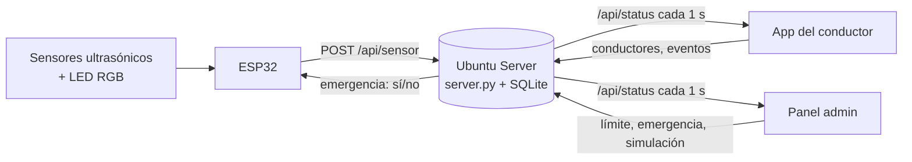

# 🅿️ ParkUni

**Estacionamiento inteligente para el campus.** Sensores ultrasónicos con LED RGB en cada cajón le dicen a una app web, en tiempo real, cuáles están libres. La app funciona como un "Waze" del estacionamiento: asigna el cajón disponible más cercano **por ruta real**, guía con indicaciones de giro y voz, **redirige** si alguien ocupa el lugar mientras el conductor llega y vigila el **límite de velocidad** con el GPS del celular.

> Proyecto escolar — Circuitos, Semestre 3.

## 🎨 Identidad visual

Paleta de la Universidad Anáhuac Cancún: **blanco y naranja** de día, **negro y naranja** de noche, con grises neutros. El naranja (`#f7941d`) marca lo importante (botones, ruta, cajón asignado); el verde y el rojo se reservan para libre / ocupado. Las variables de color están al inicio de [`public/css/base.css`](public/css/base.css) y [`map.css`](public/css/map.css). El logo está en `public/img/` (versión clara y versión para fondo oscuro).

## 🗺️ Dos mapas

| Mapa | Para qué sirve |
|---|---|
| **Prototipo** (por defecto) | La maqueta con los **4 sensores reales**: un pasillo con 4 cajones. Todo lo que se ve viene de los sensores, sin simulación. Es la prueba. |
| **Campus completo** | El estacionamiento real de la universidad (~590 cajones en 5 zonas), para mostrar **cómo se vería si se usara**. Solo los cajones con sensor son reales; el resto se simula. |

Se cambia con el selector del panel de administración o en ⚙ Ajustes → *Mapa* de la app (también con `?map=prototype` o `?map=campus` en la URL).

## ✨ Funciones

**App del conductor** (`index.html`)
- Asignación del cajón libre más cercano respetando carriles de un solo sentido y la rotonda.
- Mapa que gira con el auto e instrucciones tipo "Entra a la rotonda, salida 2 hacia Acceso norte, 89 m".
- **Redirección automática** si el cajón asignado se ocupa en camino (en el campus, si no queda nada, manda a la Terrazería o a la zona de maestros).
- **Velocidad por GPS** con alerta visual, sonora y de voz al pasar el límite.
- Voz con prioridades: *emergencia* > *reducir velocidad* > *redirigiendo* > *guía de giros*.
- Aviso de **emergencia** a pantalla completa cuando el administrador la activa.
- Tema claro de día y oscuro de noche (automático por hora, con opción manual) y modo demo para presentar sin salir a la calle.

**Panel de administración** (`admin.html`)
- KPIs, estado de cada sensor (distancia, "sin señal"), límite de velocidad, conductores en camino y bitácora.
- **Botón de EMERGENCIA** (ver abajo).
- En el campus: mapa central rodeado de vistas ampliadas por zona (Norte, Acceso norte, Acceso, Este y Sur) con cada cajón en uso; tocar el título de una zona la amplía en el mapa central. Control de la simulación de los cajones sin sensor.
- Tocar un cajón lo fuerza a ocupado / libre / automático (para pruebas).

## 🚨 Emergencia / simulacro

En el panel hay una tarjeta **Emergencia / simulacro**. Al activarla con la contraseña, **los LED RGB de todos los sensores parpadean en morado** (emergencia) y la app de los conductores muestra un aviso con voz. Se desactiva con la misma contraseña y los LED vuelven a verde/rojo.

- La contraseña se verifica **en el servidor** (no está en el código de la página). Para cambiar la que trae por defecto define `PARKUNI_EMERGENCY_PASSWORD` (ver `server/parkuni.service`).
- 5 intentos fallidos bloquean la prueba durante un minuto y quedan en la bitácora.
- El ESP32 se entera en la respuesta de su siguiente reporte (≈ 1.5 s).

## 🧩 Arquitectura



El mismo servidor sirve la app web y guarda todo en una base SQLite. Para publicarlo en internet, un **Cloudflare Tunnel** apuntando a `localhost:8000` da https sin abrir puertos (y el GPS del celular lo exige).

## 🔌 Hardware (ESP32 + 4 sensores)

Ficha técnica completa: [`docs/Ficha_Tecnica_Estacionamiento.docx`](docs/Ficha_Tecnica_Estacionamiento.docx). ESP32 de 38 pines, 1× AJ-SR04M (impermeable) y 3× HC-SR04, con LED RGB de cátodo común (verde = libre, rojo = ocupado, azul sin uso).

| Cajón | Sensor | ID | Límite | TRIG | ECHO* | LED R | LED G | LED B |
|---|---|---|---|---|---|---|---|---|
| 1 | AJ-SR04M (impermeable) | A1 | 50 cm | 23 | 34 | 32 | 25 | 33 |
| 2 | HC-SR04 | A2 | 10 cm | 22 | 35 | 26 | 27 | 14 |
| 3 | HC-SR04 | A3 | 10 cm | 21 | 36 | 16 | 18 | 17 |
| 4 | HC-SR04 | A4 | 10 cm | 19 | 39 | 5 | 2 | 4 |

\* Cada ECHO lleva un divisor de voltaje (1 kΩ en serie y 2 kΩ a GND) para bajar los 5 V del sensor a 3.3 V. Los sensores se alimentan del pin VIN (5 V); GND común para sensores, cátodos de los LED y divisores.

Firmware:
- [`firmware/parkuni/parkuni.ino`](firmware/parkuni/parkuni.ino) — **el de producción**: mide, pinta los LED, reporta al servidor y parpadea en morado en emergencia. Antes de cargarlo pon en `SERVER_URL` la IP del Ubuntu Server.
- [`firmware/prueba_hardware/prueba_hardware.ino`](firmware/prueba_hardware/prueba_hardware.ino) — el sketch original sin WiFi, para comprobar el cableado.

El id de cada sensor se enlaza con su cajón en `MAP.sensors` de [`public/js/map-data.js`](public/js/map-data.js).

## 📁 Estructura

```
.
├── public/                    ← La app web (la sirve server.py)
│   ├── index.html             App del conductor
│   ├── admin.html             Panel de administración
│   ├── css/                   base.css · map.css · driver.css
│   ├── img/                   Logo de la universidad y favicon
│   └── js/
│       ├── config.js          Configuración, tema, GPS y llamadas a la API
│       ├── map-data.js        LOS DOS MAPAS: carriles, filas de cajones, sensores, zonas
│       ├── graph.js           Ruteo, instrucciones de giro, ocupación y simulación
│       ├── mapview.js         Dibujo del mapa (SVG)
│       ├── driver.js          Navegación, voz, velocidad, GPS, emergencia
│       └── admin.js           Panel de administración
├── server/
│   ├── server.py              Servidor + API + SQLite (solo librería estándar)
│   └── parkuni.service        Servicio systemd para Ubuntu
├── firmware/
│   ├── parkuni/               Firmware del ESP32 (sensores + LED + servidor)
│   └── prueba_hardware/       Prueba del cableado sin WiFi
├── docs/                      Ficha técnica del prototipo y guía de montaje en Ubuntu (MONTAJE_UBUNTU.md)
└── README.md
```

## 🚀 Cómo correrlo

```bash
python3 server/server.py          # http://localhost:8000  (conductor)  ·  /admin.html (panel)
python3 server/server.py --https  # https autofirmado, para probar el GPS desde el celular por la red local
```

Sin ESP32 puedes probar todo: el panel permite forzar cajones y, en el campus, simular el resto. Para simular el reporte de un sensor:

```bash
curl -X POST localhost:8000/api/sensor -d '{"sensors":{"A1":{"occupied":true,"distance_cm":12}}}'
```

### En el Ubuntu Server
1. Copia el proyecto a `/opt/parkuni` y crea el usuario del servicio.
2. Instala el servicio: `sudo cp server/parkuni.service /etc/systemd/system/`, edita rutas y contraseña, y `sudo systemctl enable --now parkuni`.
3. (Opcional) Cloudflare Tunnel: `cloudflared tunnel --url http://localhost:8000` para tener https público.
4. La base queda en `server/data/parkuni.db` (haz respaldo de ese archivo).

## 🗺️ Cómo está hecho el mapa

Los dos mapas están en [`map-data.js`](public/js/map-data.js):

| Elemento | Qué es |
|---|---|
| `nodes` / `edges` | Red de **carriles de un solo sentido** (de `a` a `b`). El ruteo usa solo esto, así que nunca manda a nadie en contra. |
| `segments` | Filas de cajones con su cantidad `n`. Id de cajón: `<fila>-<número>` (p. ej. `S05-12`). |
| `sensors` | Qué sensor del ESP32 es qué cajón (`A1: 'P-1'`). |
| `overflow` | (Campus) Terrazería y zona de maestros: último recurso, sin sensores. |
| `simulate` | `false` en el prototipo: solo cuenta lo que miden los sensores. |

El campus sale de un dibujo del estacionamiento (1920×1080 px, ≈ 0.2 m por píxel).

## 🗄️ Datos (API del servidor)

| Ruta | Quién | Para qué |
|---|---|---|
| `POST /api/sensor` | ESP32 | Reporta los sensores y recibe `emergency` |
| `GET /api/status` | Apps | Estado completo (sensores, límite, conductores, emergencia; eventos con `?events`) |
| `POST /api/emergency` | Panel | `{on, password}` activa o desactiva la emergencia |
| `POST /api/config` · `/api/sim` · `/api/override` | Panel | Límite de velocidad, simulación y cajones forzados |
| `POST /api/driver` · `/api/event` | App | Latido del conductor y eventos |

## ⚠️ Pendientes y limitaciones

- La API no tiene inicio de sesión: el panel de administración está abierto para quien llegue a la URL. La emergencia sí pide contraseña, pero antes de publicar el sitio conviene proteger `admin.html` y las rutas de escritura (por ejemplo con Cloudflare Access).
- En producción define `PARKUNI_EMERGENCY_PASSWORD` en vez de usar la contraseña por defecto del código.
- Los sentidos de algunos carriles de la zona este del campus son una interpretación del dibujo: conviene recorrerlos y corregirlos en `map-data.js`.
- Para ver la posición real del GPS hay que calibrarlo (⚙ → *GPS del celular* → *Fijar entrada*).
